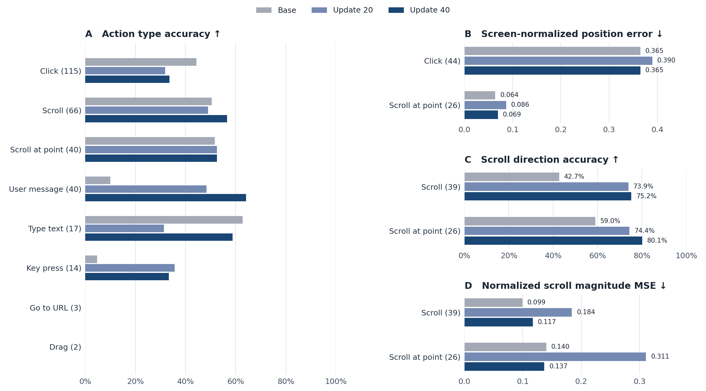

# Predicting the next human browser action

Hanbo Xie · Jurny ML Engineer Take-Home

## Setup

I chose Qwen2.5-VL-3B-Instruct for screenshot input and local LoRA training. Given the task and browsing history, it predicts the next action. Training averages cross-entropy over recorded action tokens within each trajectory. I split 200 trajectories into 160 train, 20 validation, and 20 test. Validation contains 297 action targets.

## Evaluation and explanation

1. **Metrics.** NLL averages target-token negative log-likelihood within each action, then over actions. Generated actions receive format-validity, type-accuracy, and joint type-and-parameter scores. Among correct types, I measure:
   - Clicks, drag endpoints, and scroll anchors using Euclidean pixel distance and distance normalized by screen width and height.
   - Scrolling using direction accuracy, normalized displacement distance, and MSE of normalized scroll magnitude. Magnitude MSE is read alongside direction because it discards sign.
   - Text using exact match and character similarity, and keys and URLs using exact match.

   Joint match uses tolerances of 0.05 for normalized position and 0.25 for scroll displacement, plus direction and other relevant checks. Invalid outputs count as overall failures. The position tolerance is an offline proxy. In a live browser, clicks at different points on a button should count as equivalent if they trigger the same UI outcome from the same starting state.

2. **Comparison procedure.** I saved checkpoints at updates 20 and 40 during one training epoch. Both checkpoints and the base model use identical validation IDs, screenshots, histories, scoring rules, and sampling settings. Teacher-forced evaluation scores human target tokens. One-step-ahead inference generates a complete next action, then resumes recorded history for the following prefix. Parameter errors are averaged within prefixes and compared on prefixes scorable by all three models.

3. **Sampling budget.** Local compute limited each prefix to three parallel actions per model (891 total, temperature 0.8, top-p 0.95). An engine such as vLLM could support more draws and reduce sampling uncertainty. Comparisons should keep K fixed because any-of-K coverage rises with K. [vLLM prefix caching](https://docs.vllm.ai/en/latest/features/automatic_prefix_caching/)

4. **Limitations.**
   - SFT uses positive demonstrations, with no explicit rejected alternatives or labels for their consequences. Increasing demonstrated-action likelihood can suppress unobserved alternatives without identifying which are harmful and which are valid.
   - Human trajectories cover limited states and actions. Matching them provides limited evidence about learning webpage transitions or human adaptation. Simulation may therefore be biased in unfamiliar states.

5. **Closed-loop follow-up.** I would execute actions and feed resulting pages back to the model. Evaluation would compare task completion, elapsed time, action count, repeated attempts, backtracking, and position corrections with human trajectories, accounting for inference latency. Local runtime constraints kept this run to offline NLL and one-step inference.

## Quick results

| Validation metric | Base | Update 20 | Update 40 |
| --- | ---: | ---: | ---: |
| Mean action token NLL ↓ | 1.486 | 1.152 | **1.101** |
| Action type accuracy ↑ | 40.5% | 40.3% | **46.2%** |
| Joint match ↑ | 7.5% | 14.6% | **19.6%** |
| At least one joint match in three draws ↑ | 12.8% | 24.9% | **28.6%** |

Counts show all validation prefixes in panel A and common scorable prefixes in panels B, C, and D. All three models had zero type hits for URL jumps and drags.

At update 40, scroll direction accuracy rose from 42.7% to 75.2% on 39 shared plain-scroll prefixes. On the same prefixes, scroll magnitude MSE rose from 0.099 to 0.117. Mean normalized click distance remained 0.365 on 44 shared click prefixes, while click type accuracy fell. Message exact-match gains came from the `[EXIT]` action. The test split remains held out.

AI assistance. I used Codex to help implement, debug, and document the pipeline.
